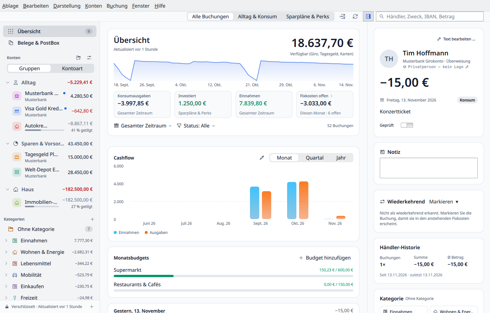
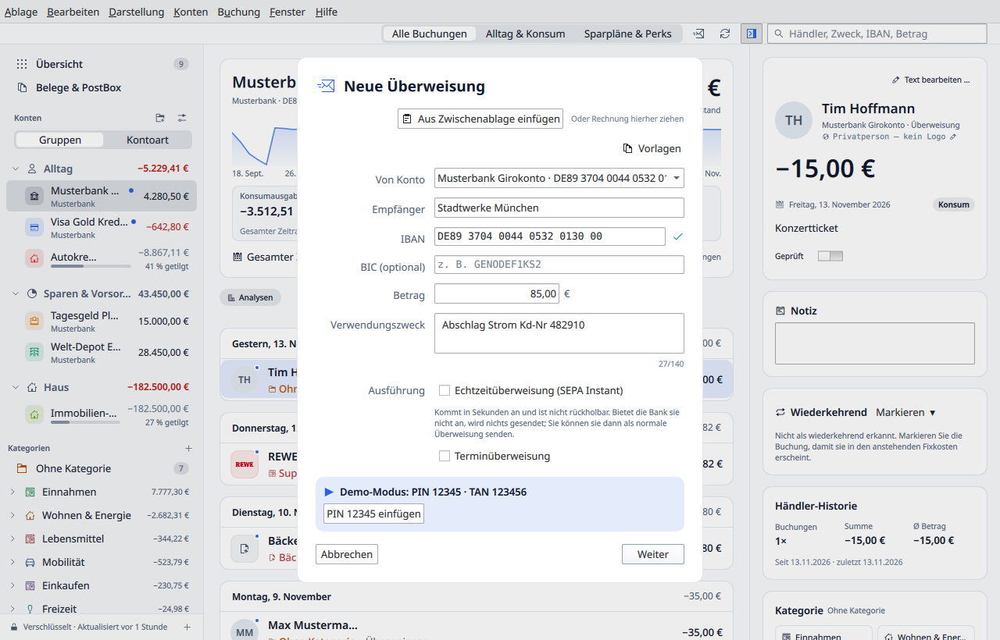
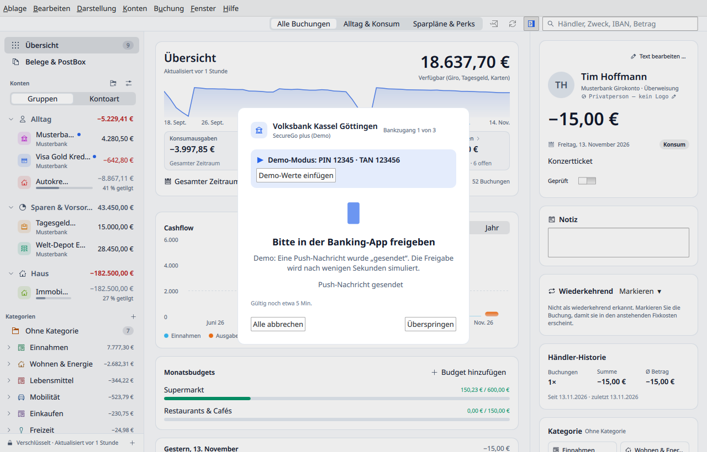
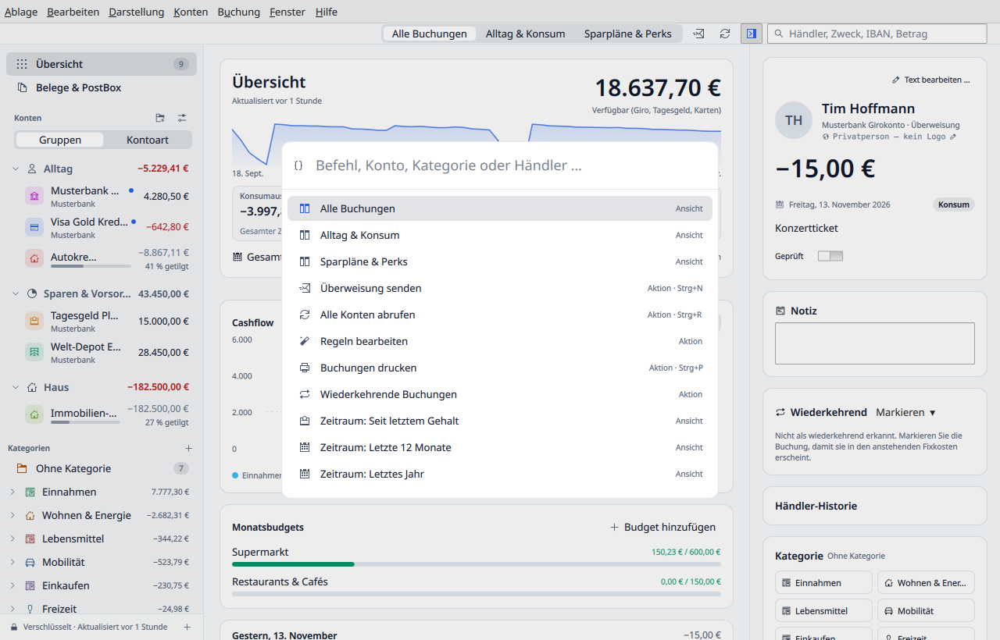
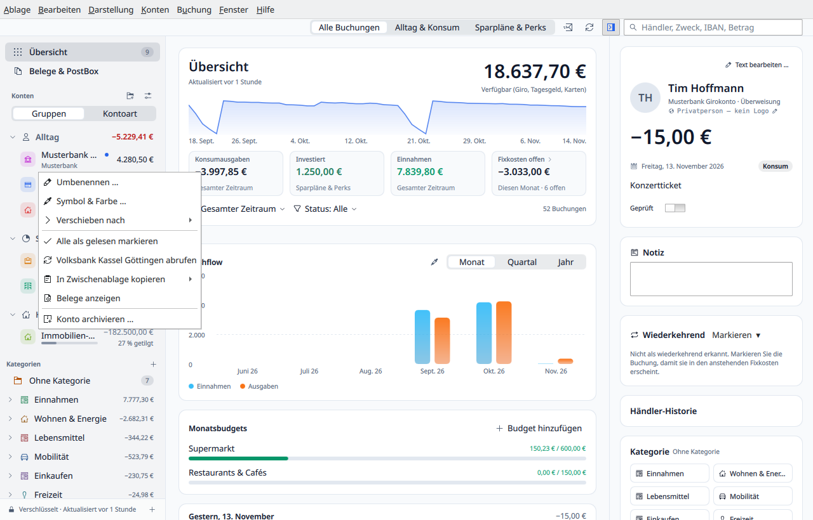
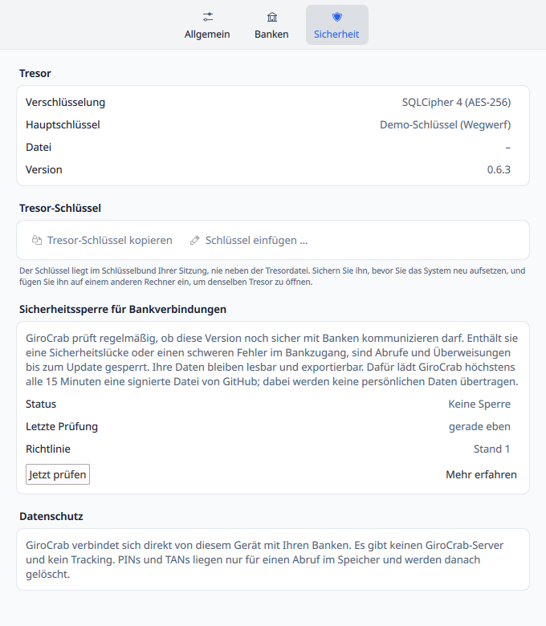

# GiroCrab für Linux (Qt 6 / QML)

Linux-Oberfläche für GiroCrab auf demselben Rust-Kern (`girocrab-core`) wie die Mac- und iOS-App.
Die QML-Ansichten bilden die SwiftUI-Ansichten aus `GiroCrabApp/Sources/GiroCrabUI` Datei für Datei nach:
gleiche Struktur, gleiche Texte, gleiche Design-Tokens (`Theme`), gleiche Logik im `AppModel`.

## Screenshots (Demo-Daten)

| Hauptfenster | Überweisung |
|---|---|
|  |  |
| **Abruf mit S-pushTAN** | **Befehlspalette (Strg+K)** |
|  |  |
| **Kontomenü** | **Einstellungen › Sicherheit** |
|  |  |

## Architektur

```
QML (qml/*.qml)  ──Core.call / Core.callAsync (JSON)──▶  src/bridge.rs (cxx-qt QObject „Core“)
                                                          └─ src/dispatch.rs ─▶ girocrab_core::Vault
```

- **Kein UniFFI auf Linux.** Die Oberfläche ruft die Rust-API direkt auf. Die FFI-Records und -Enums des Kerns
  werden über das optionale Feature `serde` von `girocrab-core` nach JSON (de)serialisiert. Die Mac-App
  baut ohne dieses Feature und bleibt unverändert.
- `src/dispatch.rs`: eine Zeile pro Kernmethode (`vault_methods!`). Argumentnamen = Rust-Parameternamen (snake_case).
- `Core.callAsync` läuft in einem Worker-Thread und antwortet über das Signal `finished(ticket, json)`.
  Das ist das Gegenstück zu `AppModel.offMain` in Swift.
- `AppModel.qml` (Singleton) entspricht `AppModel.swift`. `Theme.qml` und `Fmt.qml` entsprechen `Formatting.swift`.
  `SF.qml` ordnet SF-Symbol-Namen (die im Tresor gespeichert sind) Breeze-Icons zu.
- Eigener Cargo-Workspace: `cargo clippy --workspace` der Mac-CI braucht kein Qt.

## Bauen und starten

Voraussetzungen (Debian/Ubuntu/Kubuntu): Rust (rustup) sowie
`qt6-base-dev qt6-declarative-dev qml6-module-qtquick-dialogs qml6-module-qtquick-controls qml6-module-qtquick-layouts qml6-module-qtquick-shapes qml6-module-qt-labs-qmlmodels`
und Kirigami (`qml6-module-org-kde-kirigami`, für die Breeze-Icons). Für die Zustimmungsseiten der Banken und die PDF-Vorschau
zusätzlich `qml6-module-qtwebengine` und `qml6-module-qtquick-pdf` (werden erst bei Bedarf geladen).
Optional `tesseract-ocr tesseract-ocr-deu`: Texterkennung für fotografierte Kassenbons und Rechnungen (wie Vision auf dem
Mac). Ohne das Programm oder die deutschen Sprachdaten werden Fotos nur nach Betrag, Datum und Dateiname zugeordnet.
Zum Drucken braucht die App `qml6-module-qtwebengine` und `qt6-image-formats-plugin-pdf`: Wie auf dem Mac setzt eine
Browser-Engine den Bericht, mit demselben HTML, Stylesheet und Seitenumbruch-Skript. CSS und Skript liest `build.rs` beim
Bauen direkt aus `GiroCrabApp/Sources/GiroCrabUI/PrintReport.swift`, damit beide Ausdrucke gleich bleiben. Vor dem Druck
zeigt eine Vorschau alle Seiten; „In Datei drucken“ speichert das PDF unverändert.
Auch die Web-Logins (Trade Republic, Amex, Amazon, FNZ, quirion) brauchen nur `qml6-module-qtwebengine` zur Laufzeit:
`cpp/webcookies.cpp` liest den Cookie-Speicher von QtWebEngine ohne gegen QtWebEngine zu linken (QtNetwork aus
`qt6-base-dev` genügt zum Bauen); fehlt das Modul, startet die App trotzdem und meldet es erst beim Web-Login.

```sh
cd GiroCrabLinux
cargo run                                  # startet mit dem Demo-Tresor
cargo run -- --screenshot /tmp/shot.png    # rendert einmal, speichert ein Bild, beendet sich
cargo run -- --demo-settings banks:edit --screenshot /tmp/s.png   # Einstellungen-Fenster
cargo run -- --demo-sheet recurring --screenshot /tmp/r.png       # ein Sheet mit erfundenen Daten
```

## Flatpak

Für Fedora, openSUSE, Arch und andere Distributionen ohne `.deb`: `packaging/flatpak/de.girocrab.GiroCrab.yml`
(KDE-Runtime 6.11 mit Qt 6 und Kirigami, QtWebEngine/QtPdf aus `io.qt.qtwebengine.BaseApp`, Tesseract 5.5 mit
deutschen und englischen Sprachdaten). Die CI (`.github/workflows/flatpak.yml`) legt für x86_64 und aarch64 je ein
`girocrab.flatpak` als Workflow-Artefakt ab. Selbst bauen (aus dem Wurzelverzeichnis des Repositorys):

```sh
flatpak install --user flathub org.flatpak.Builder
flatpak run org.flatpak.Builder --user --install-deps-from=flathub --force-clean --repo=repo \
  build-dir GiroCrabLinux/packaging/flatpak/de.girocrab.GiroCrab.yml
flatpak build-bundle repo girocrab.flatpak de.girocrab.GiroCrab
flatpak install --user girocrab.flatpak && flatpak run de.girocrab.GiroCrab
```

Meldet der Builder „Failure spawning rofiles-fuse“, `--disable-rofiles-fuse` ergänzen. Der Bau läuft ohne Netz: alle Quellen sind per sha256 festgelegt, die Crates stehen in
`packaging/flatpak/cargo-sources.json`. Nach jeder Änderung an `Cargo.lock` `packaging/flatpak/update-cargo-sources.sh`
ausführen und das Ergebnis mit committen (die CI prüft das).

Berechtigungen:

| Berechtigung | Wofür |
|---|---|
| `--socket=wayland`, `--socket=fallback-x11`, `--share=ipc`, `--device=dri` | Fenster und GPU (Qt Quick) |
| `--share=network` | Abruf bei den Banken, Web-Logins |
| `--talk-name=org.freedesktop.secrets` | Tresor-Schlüssel im Secret Service (GNOME Keyring, KWallet, KeePassXC) |
| `--socket=cups` | Drucken |
| `--filesystem=xdg-config/kdeglobals:ro` | Plasma-Farben und -Schriften |
| `--filesystem=xdg-download:ro` | Per Drag & Drop abgelegte Kontoauszüge, Rechnungen und Belegfotos kommen als Pfad an, meist aus „Downloads“ |

Dateidialoge (Import, Export, Belege sichern, MoneyMoney-Datenbank oder -Ordner) laufen über das
Dateiauswahl-Portal und brauchen keine Dateisystem-Berechtigung. Ausnahmen: Dateien, die von anderswo als „Downloads“
ins Fenster gezogen werden, liest die App nur, wenn der Dateimanager sie über das Portal freigibt; sonst den Dialog
nehmen. Wird nur `MoneyMoney.sqlite` gewählt, sieht die App den Ordner `Statements` daneben nicht: den ganzen
MoneyMoney-Ordner oder den Kontoauszugsordner extra wählen. „Als PDF drucken“ kann nur in Ordner schreiben, auf die
die App Zugriff hat (z. B. per `flatpak override --user --filesystem=xdg-documents de.girocrab.GiroCrab`).

**Eigener Tresor:** Das Flatpak sieht `~/.local/share/GiroCrab` nicht. Sein Tresor liegt in
`~/.var/app/de.girocrab.GiroCrab/data/GiroCrab/tresor.girocrab`, die Einstellungen unter
`~/.var/app/de.girocrab.GiroCrab/config/`. Der Schlüssel im Secret Service ist derselbe Eintrag wie beim `.deb`; wer
von der nativen Installation wechselt, kopiert `tresor.girocrab` in den neuen Ordner.

## Port-Status

| Swift-Datei | QML / Rust | Stand |
|---|---|---|
| RootView | Main.qml | Fenster, Menüs, Toolbar, Dreispalten-Layout, alle Sheets, Fehler-Alert |
| AppModel, AccountGroupsModel | AppModel.qml | Auswahl, Zeitraum, Filter, Laden, Tagesgruppen, Marker, KPIs, Bearbeiten, Abruf, Überweisung, Import |
| Formatting | Theme.qml, Fmt.qml | Tokens, Money, DateText, IBAN |
| TextSize | Theme.qml, GeneralSettings.qml, Main.qml | Schriftgröße ×1 / ×1,15 / ×1,3 (Einstellungen › Allgemein, Darstellung › Größer Strg++ / Kleiner Strg+- / Originalgröße Strg+0; QSettings `textSize`). Skaliert die Textstile, die Standardschrift der Steuerelemente, Seitenleisten-, Sheet- und Einstellungsbreite sowie die Signets wie auf dem Mac; Menüs bleiben in Systemgröße |
| SidebarView, AllAccountsRoot, AccountGroupsUI | SidebarView.qml, SidebarRow.qml, AccountRow.qml, NewCountBadge.qml, AccountsSectionHeader.qml, DropSlot.qml | „Alle Konten“ mit Summe je Währung, Gruppen/Banken/Kontoart, Kontosuche, Konten mit Inhaber-Kürzel und Zähler-Blasen, „Neue Umsätze“, Belege, einklappbarer Kategorienbaum, Fußzeile, Drag & Drop, Kontextmenüs (Kontoart, Kontoinhaber) |
| NewBookingsView, NewBookings | BookingStreamView.qml (NewBookingsCardHeader), AppModel.qml (newBookingSections) | „Neue Umsätze“: eine Karte je Konto mit den ungeprüften Buchungen |
| BookingListView | BookingStreamView.qml | Tageskarten, Zeilen, Chips, Mehrfachauswahl, Kontextmenü, Tastatur (Pfeile, C, R), „Weitere Buchungen laden“. Nur unter Linux: Beim Scrollen zeigt eine Blase am Griff den Tag der obersten Buchung, im noch nicht geladenen Bereich geschätzt („ca. März 2021“) |
| BalanceHeaderView | StreamHeaderCard.qml, KPI.qml, BalanceChart.qml, HoldingsCard.qml | Titel, Saldo, Linien-Chart, KPIs, Filterzeile, Depot-Positionen. Balken-Stil entfällt. |
| PlanningUI | CashflowCard.qml, BudgetProgressCard.qml, BudgetEditorSheet.qml, SplitSheet.qml, CustomPeriodForm.qml | Karten, Budget-Editor, Umsatz aufteilen, eigener Zeitraum (QSettings `period/customFrom`, `period/customTo`) |
| BookingDetailView | InspectorView.qml | Beleg, Notiz, Gehalt, Wiederkehrend, Händler-Historie, Kategorie-Raster, Rohdaten, Belege, Mehrfachauswahl |
| AmazonOrderRef | AmazonOrderRef.qml, BookingStreamView.qml (BookingRow), InspectorView.qml (ReceiptCard, RawDataCard), Theme.qml | Amazon-Buchungen (#333, #349, #354): Zeile mit den ersten zwei Artikeln, „+N weitere“, „Abo“, Bestellnummer und Aufklapp-Pfeil für alle Artikel (bei Erstattungen die der erstatteten Bestellung), Betrag ohne Vorzeichen als roter bzw. grüner Badge; im Detail ein Artikel je Zeile, Artikel mit ASIN öffnen die Produktseite, „Erstattung zu: …“ springt zur Bestellung; Rohdaten mit Bestellnummer als Link zur Bestellung und Bestelltyp |
| RecurringUI | InspectorView.qml (RecurringCard), RecurringSheet.qml, CustomDatesSheet.qml | Karte mit „Individuell …“, Übersicht „Wiederkehrende Buchungen“, ausgeblendete Serien |
| CommandPalette › CategorizerSheet, RuleEditorView | CategorizerSheet.qml, RuleEditorView.qml, RuleForm.qml | Kategorisieren (C, auch Mehrfachauswahl), Regelliste, Editor (Stichwörter, Regex, Suchausdruck), Live-Vorschau, „Regel für diesen Händler erstellen …“ (R) |
| NewCategoryDialog, SymbolPicker, IconColorPopover | NewCategoryDialog.qml, SymbolPicker.qml, ColorSwatches.qml, IconColorPopover.qml, CategoryDialogs.qml | Neue Kategorie, Farbwahl mit eigenen Farben, Kontextmenü (Umbenennen, Symbol & Farbe, Verschieben, Unterkategorie, Budget, Löschen). Symbole: nächstes Breeze-Icon (SF.qml) |
| MerchantSignet | MerchantSignet.qml, AccountSignet.qml, SymbolTile.qml | Monogramm, Person, simple-icons-SVG. Online-Logos entfallen. |
| Onboarding | BookingStreamView.qml (DemoBanner), DemoHintBanner.qml | Banner, Demo-Hinweise |
| AnimatedCrabLogoView | AnimatedCrabLogo.qml | Animierte Vektor-Krabbe (Qt Quick Shapes): Münzwurf mit Karten-Glanz beim Erscheinen und per Klick, Schweben mit Bodenschatten, Blinzeln, Blick beim Entsperren, Freudensprung nach dem Entsperren, fragender Blick bei Fehler. Auf dem Startbild (Main.qml), dem Sperrbildschirm (LockView.qml) und in „Willkommen bei GiroCrab“ (BookingStreamView.qml › EmptyVaultCard). Die 3D-Drehung der Münze ist ohne Perspektive; „Bewegung reduzieren“ fragt Qt unter Linux nicht ab (Eigenschaft `reduceMotion`) |
| VaultKeyManager | src/vault_key.rs, LockView.qml, KeyPasteSheet.qml | Secret Service (KWallet / GNOME Keyring) statt Keychain, Sperrbildschirm, Schlüssel sichern/wiederherstellen |
| AppModel+Reset, VaultResources | SecuritySettings.qml, AppModel.qml, src/dispatch.rs (`reset_app`), src/vault_key.rs | Einstellungen › Sicherheit › „App zurücksetzen …“: löscht Tresor (mit `-wal`/`-shm`/`-journal`), entschlüsselte Belegkopien, Einstellungen (`GiroCrab.conf`) und zuletzt den Schlüssel im Secret Service. Danach startet die App neu (statt wie am Mac im laufenden Prozess) und zeigt wie beim ersten Start die Demo. Die Richtlinie der Sicherheitssperre (`banking-policy.json`) bleibt. Keine Abfrage von Touch ID / Gerätecode (gibt es unter Linux nicht) |
| ConnectionsUI, AddBankAssistant, BankPicker, FinTsAddForm, EnableBankingSetup | AddBankSheet.qml, BankSetupSheet.qml, SettingField.qml, ConnectionEditSheet.qml, ConfirmDialog.qml, EnableBankingSetupSection.qml | Bank hinzufügen, Einrichten, Bearbeiten, Entfernen, PSD2-Zustimmung + „Neu verbinden …“, Web-Sitzung (Cookies) löschen, CSV/PDF-Kontoauszug-Import, Trade Republic „Im Browser-Fenster anmelden …“ |
| AccountSelectionView | AccountSelectionList.qml, AccountSelectionPanel.qml, AccountSelectionSheet.qml, AppModel.qml, ConnectionEditSheet.qml, FnzWebLoginFlow.qml, WebLoginSheet.qml | Kontoauswahl pro Bankzugang (#346): Liefert ein Abruf Konten, die schon über einen anderen Zugang eingebunden sind, fragt die App danach (auch nach quirion), welche abgerufen werden; beim FNZ-Abruf über dem Browser, bevor die PDFs geladen werden. Bankzugang bearbeiten › „Kontenauswahl“ ändert die Wahl später |
| TwoFactorSheet, PSD2Consent, ConsentBrowser, AutoSyncState | TwoFactorSheet.qml, PinSheet.qml, ConsentBrowser.qml (QtWebEngine), SyncPromptButtons.qml, SyncBatchProgressLabel.qml, src/sessions.rs | Abruf einzeln und „Alle abrufen“, PIN, TAN (Push, Eingabe), Zustimmung im Browserfenster |
| TransferSheetView, PayeeCheckSheet, GiroCode, PaymentParser | TransferSheet.qml, PayeeCheckSheet.qml, GiroCode.qml, GiroCodeImage.qml, PaymentParser.qml | Formular, Vorlagen, Echtzeit/Termin, Empfängervorschläge, Einfügen, Rechnung (ZUGFeRD-XML, PDF-Text) per Drag & Drop, Bestätigung, GiroCode, Namensprüfung, TAN. Fehlt: QR-Erkennung in Bildern/PDFs |
| BankingPolicy | src/banking_policy.rs, BankingPolicyBanner.qml, SecuritySettings.qml | signierte Richtlinie, Distribution `linux`, Abschnitt in Einstellungen › Sicherheit. Das Projekt veröffentlicht noch keine Regeln für `linux`. |
| DocumentsUI, AccountDocumentsUI | DocumentsView.qml, DocumentPreview.qml (QtPdf), AccountDocumentsSheet.qml | Belege, Vorschau, Zuordnen, Kontoauszüge, Sichern. Texterkennung für Fotos mit dem optionalen `tesseract` statt Vision (src/ocr.rs, Bild per stdin, ohne HEIC) |
| InvestmentDashboardView, LoanProgressCard | InvestmentDashboardView.qml, HoldingsCard.qml, LoanProgressCard.qml | Depot-Übersicht, Sparpläne, Perks, „Konsum vs. Investition“ mit Werteachse, Kredit-Fortschritt |
| WealthView | WealthView.qml, Main.qml (Ansicht in der Toolbar), SidebarView.qml, AppModel.qml | „Vermögen“: Nettovermögen mit Balken, Zusammensetzung (Ring), Cash-Verlauf, Kontolisten, Positionen aller Depots, Erträge und Kosten, Positionen der Sachwerte; Ansicht Alles/Cash/Wertpapiere/Sachwerte (QSettings `wealth/includeLiabilities`) |
| TangibleAssetsUI, AppModel+Assets, DepotPositionsView (Sachwerte) | AssetPositionsView.qml, AssetEditorSheet.qml, AssetActionSheet.qml, AssetSymbols.qml, AssetSymbolPicker.qml, AssetSymbolTile.qml, AssetSymbolImage.qml, NumberText.qml, StreamHeaderCard.qml, AppModel.qml | Sachwerte-Konto (Ablage, Befehlspalette), Positionen und „Ehemalige Positionen“, Auswahl mit eigenem Wertverlauf im Kopf („Wert heute“/„Verkauft“), Sachwert anlegen/bearbeiten (Gold mit Stückelung oder eigenen Angaben, Kaufpreis gesamt/je Stück, fehlender Kurs), Bewertungen, Anzahl, Verkaufen, Löschen, „Kurse aktualisieren“ (Goldpreis per `refresh_asset_prices` im Worker-Thread). Symbole: nächstes Breeze-Icon, Edelstein und Kette selbst gezeichnet. Eingabezeilen für neue Bewertung und Anzahl zweizeilig (das Datumsfeld ist breiter als am Mac) |
| MoneyMoneyImportSheet, MoneyMoneyDatabaseImportView | MoneyMoneyImportSheet.qml, MoneyMoneyExportImportView.qml, MoneyMoneyDatabaseImportView.qml, ImportAssistantHeader.qml, AssistantFooter.qml, ImportSourceSection.qml, ImportFileRow.qml, FormSection.qml, FormRow.qml | Exportdatei (CSV/XML/CAMT/MT940) und Datenbank (SQLCipher, Fortschritt, Abbrechen, Abgleich). Datenbank bzw. MoneyMoney-Ordner vom Mac kopieren. Enable-Banking-Schritt ohne Live-Bankliste |
| PrintSheet, PrintReport | PrintSheet.qml, PrintReport.qml, cpp/printing.cpp | QTextDocument + QPrinter/QPrintDialog (auch PDF), Fußzeile, Logo, Wasserzeichen |
| AppModel.exportFilteredBookingsCSV | Main.qml (FileDialog), AppModel.qml | Ablage › „Umsätze als CSV exportieren …“: „GiroCrab-Buchungen.csv“ |
| ExportSheet, BookingExport, AppModel+Printing (Export) | ExportSheet.qml, BookingExport.qml, PrintReport.qml, Main.qml, src/dispatch.rs | Umsätze als PDF (Umsatzliste A4, über WebPrinter.qml wie der Druck), CSV und CAMT.053 (.001.08 / .001.02, aus dem Kern; für einen Zeitraum oder lückenlos markierte Buchungen, nicht für Darlehen und Depots): Ablage, Befehlspalette, Kontextmenü der Buchung. Konten nach Bank, Zeitraum, Format, Optionen (QSettings `export/options`), „Speichern“ nach Downloads bzw. in den zuletzt benutzten Ordner ohne Überschreiben, „Unter …“ mit Dateidialog, „Jedes Konto einzeln“ |
| SettingsView, AutoReview | SettingsWindow.qml, GeneralSettings.qml, BankConnectionsSettings.qml, SecuritySettings.qml, SettingsFormSection.qml, SettingsFormRow.qml | eigenes Fenster (Strg+,): Allgemein (mit Sprache), Banken, Sicherheit. Entfällt: Mitteilungen, Saldoverlauf-Stil, Händler-Logos, Dokumente-Ordner, Updates, Touch ID, iCloud-Sync |
| SyncLog | SyncLogWindow.qml | Fenster › Abruf-Protokoll: Suche, Konto-Filter, „Nur Fehler“, Sortierung, CSV-Export, Leeren |
| HelpView | HelpWindow.qml | Hilfe › GiroCrab-Hilfe (Strg+?). Themen und Kürzel-Beschriftungen (de/en) liest `build.rs` direkt aus HelpView.swift; Tresor-Thema und Tastaturkürzel für Linux angepasst |
| BugReport, BugReportUI, PrivacyRedaction | BugReportWindow.qml, Sensitive.qml, AppModel.qml, src/bug_report.rs, src/dispatch.rs, cpp/prepare.cpp | Hilfe › „Problem melden …“ (Strg+Alt+B, auch in der Hilfe unter Support, #301): eigenes Fenster mit Screenshot des Hauptfensters, in dem persönliche Daten grau abgedeckt sind, eigene schwarze Markierungen per Maus (Strg+Z / Strg+Umschalt+Z), „Kategorien ausblenden“, „Abruf-Protokoll anhängen“ und der mit `sanitize_report_text` bereinigte Diagnoseblock. „Issue auf GitHub öffnen“ legt das Bild in die Zwischenablage und öffnet ein vorausgefülltes Issue im Browser; gesendet wird nichts. Ansichten im Hauptfenster markieren persönliche Inhalte mit `Sensitive {}` (`Sensitive { labels: true }` für Kategorien, Gruppen, Budgets, Wertpapiere). Aufgenommen wird nur der Inhalt des Hauptfensters ohne Sheets und Menüs; das Bild liegt bis zum Schließen des Fensters in `$XDG_RUNTIME_DIR/girocrab-report` |
| Screenshot, LaunchOptions | Main.qml, AppModel.qml, cpp/prepare.cpp | siehe „Demo- und Screenshot-Optionen“ |
| ManualLoansUI | LoanEditorSheet.qml, LoanAssignMenu.qml, ManualLoanDetails.qml, LoanProgressCard.qml, AppModel.qml | Neues Darlehen (Ablage), Darlehen bearbeiten, Stand neu setzen, Live-Vorschau, Buchung › Darlehen zuordnen, „Neues Darlehen aus dieser Buchung …“. Fehlt: Widerrufen |
| OpeningBalanceUI | OpeningBalanceSheet.qml, AppModel.qml | Startsaldo, Stichtag, Kalibrieren, Vorschau, Entfernen. Fehlt: Widerrufen |
| PortalUI, AmazonUI, FnzUI, QuirionUI, SchwaebischHallUI, ConnectionsUI › WebLoginSheet | WebLoginSheet.qml, WebLoginFlow.qml, TrWebLoginFlow.qml, PortalWebLoginFlow.qml, AmazonWebLoginFlow.qml, FnzWebLoginFlow.qml, QuirionWebLoginFlow.qml, SchwaebischHallWebLoginFlow.qml, src/web_login.rs, cpp/webcookies.cpp | Trade Republic (Sitzung `tr_session` → Tresor), Amex / Amazon Visa (JSON-Mitschnitt, Tabelle, Blättern, Kontoauszug-Import), Amazon-Bestellungen, FNZ, quirion (Salden, Depot, Postkorb-PDFs), Schwäbisch Hall (Bausparverträge, Postfach-PDFs; Skripte in der Anwendungs-Welt, aus SchwaebischHallUI.swift generiert und per Test abgeglichen). Sitzungen bleiben über einen Neustart erhalten (wie WKWebsiteDataStore.default() in Swift): das Browserprofil ist off-the-record (nichts auf der Platte), die Cookies der Portal-Domains liegen verschlüsselt im Tresor (Einstellung `web.secret_cookies.<Zugang>`, nach erfolgreichem Abruf und beim Schließen gesichert, vor dem Laden der ersten Seite zurückgespielt; abgelaufene und fremde Cookies werden übersprungen, `tr_session` bleibt in der Trade-Republic-Sitzung). „Web-Sitzung (Cookies) löschen …“, „Sitzung löschen …“ und das Entfernen des Bankzugangs löschen sie mit. Entfallen: „Portal-Struktur prüfen“ (Entwickler), eigene Dialoge für JavaScript-Meldungen (Qt-Standarddialoge) |
| CommandPalette | CommandPaletteSheet.qml | Befehlspalette (Strg+K): Ansichten, Aktionen, Gruppen, Konten, Kategorien, Händler |
| AccountGroupsUI › Dialoge, GroupManagerSheet | AccountGroupDialogs.qml, GroupManagerSheet.qml | Neue Gruppe/Untergruppe, Umbenennen, Kontoinhaber, Löschen, Zusammenführen, Konto archivieren/löschen, Gruppen bearbeiten mit Suche und Ziehen auf Gruppen |
| Announcements | – | offen |
| SyncFolder, CloudSyncManager | – | offen: Ordner-Sync (Nextcloud/Syncthing) statt iCloud |
| LanguagePreference | GeneralSettings.qml, LanguagePromptView.qml, Main.qml, cpp/translator.cpp, src/i18n.rs | siehe „Sprache“ |
| AppUpdates (Sparkle), DockBadge, DesktopFrame, MacFrame, Perf, MerchantLogoTip, SyncDeviceID, ViewLayout, SVGPath, BankingVersion, BalanceBars | – | entfällt (macOS-spezifisch) |

## Sprache

Deutsch und Englisch wie in der Mac-App. Einstellungen › Allgemein › Sprache: „Systemsprache“, „Deutsch“ oder
„English“; gespeichert als `language` in `~/.config/GiroCrab/GiroCrab.conf` und nach „Neu starten“ wirksam, damit ein
Lauf nie Sprachen mischt. „Systemsprache“ nimmt den ersten deutschen oder englischen Eintrag aus `LANGUAGE` / `LC_ALL` /
`LC_MESSAGES` / `LANG` (`QLocale::system().uiLanguages()`), sonst Deutsch. Wie auf dem Mac fragt die App nur, wenn sich
die Systemsprache seit dem letzten Start geändert hat (`language.lastSystemLanguage`): Spricht das System keine der beiden
Sprachen, erscheint vor dem Entsperren „Sprache wählen“ (LanguagePromptView); wechselt das System weg von einer
ausdrücklich gewählten Sprache, bietet ein Hinweis einmal den Wechsel an.

- Quelltexte sind deutsch (`qsTr("…")` in QML, `QCoreApplication::translate` in C++, `i18n::tr` in Rust).
- Das Englische kommt beim Bauen aus dem String-Katalog der Mac-App (`GiroCrabApp/Xcode/App/Localizable.xcstrings`):
  `build.rs` wandelt die Swift-Platzhalter (`%@`, `%lld`, `%1$@`) in Qt-Platzhalter (`%1`, `%2`) um, nimmt bei
  Pluralformen „other“ und schreibt `OUT_DIR/en.json`. Ändert sich das Format des Katalogs, bricht der Build mit einer
  Meldung ab.
- `i18n/en-linux.json` enthält nur die Linux-eigenen Texte (Deutsch → Englisch, gleiche Platzhalter) und gewinnt
  gegen den Katalog. Begriffe wie in der Mac-App (Tresor = vault, Buchung = transaction), Schlüsselbund = keyring.
- `cpp/translator.cpp` (ein `QTranslator`, nur bei Englisch installiert) schlägt jeden Text in dieser Tabelle nach;
  ohne Eintrag bleibt der deutsche Text stehen. Zahlen und Datumsangaben folgen wie am Mac der Sprache mit der Region
  des Systems (`QLocale::setDefault`, z. B. `en_DE`); der Kern bekommt die Sprache über `i18n::set_language`.
- `python3 -I scripts/i18n-report.py` listet Texte ohne Englisch und endet dann mit Fehler (läuft in der CI).
- Die Hilfe (HelpWindow.qml) kommt zweisprachig direkt aus `HelpView.swift` (`build.rs`, `help.json`); nur das
  Tresor-Thema ist für Linux eigen (Secret Service statt Schlüsselbund von macOS, kein iCloud-Sync).
- Nicht übersetzt: Demo-Inhalte (Regel-, Konto- und Buchungsnamen) und Texte der Banken. Datei-Dialoge und Druckdialog kommen von der Arbeitsumgebung bzw. Qt.

## Demo- und Screenshot-Optionen

Dieselben Startoptionen wie in der Mac-App (`GiroCrabApp/Sources/GiroCrabUI/LaunchOptions.swift`), mit derselben
Bedeutung. Die Entwickler-Optionen der Mac-App (`--fresh-vault`, `--keep-fresh-vault`, `--developer`,
`--try-add-bank`, `--simulate-system-language`, `--show-tips`) gibt es unter Linux nicht.

```sh
cargo run -- --demo-seed                     # Wegwerf-Tresor mit Demo-Daten (auch GIROCRAB_DEMO_SEED=1|true|yes)
cargo run -- --demo-sync                     # (Demo) „Alle abrufen“ sofort, mit simulierter PIN/TAN
cargo run -- --view alltag|sparplaene|belege # (Demo) Start in „Alltag & Konsum“, „Sparpläne & Perks“ oder „Belege & PostBox“
cargo run -- --view vermoegen[-wertpapiere|-sachwerte]  # (Demo) Start in „Vermögen“ (Alles, Wertpapiere bzw. Sachwerte)
cargo run -- --select visa                   # (Demo) Konto vorwählen, dessen Name den Text enthält
cargo run -- --pick rewe                     # (Demo) Buchung vorwählen, deren Händler/Gegenseite den Text enthält
cargo run -- --demo-sheet <Name>             # (Demo) Sheet mit erfundenen Daten öffnen (Liste unten)
cargo run -- --demo-settings general|banks|groups|security[:edit|:add|:remove|:select]
                                             # (Demo) Einstellungen auf diesem Reiter, optional mit dem
                                             # Bearbeiten-/Hinzufügen-/Entfernen-Sheet der ersten Bank
                                             # (`:select`: Bearbeiten eines zweiten Zugangs mit Kontoauswahl);
                                             # `groups` öffnet den Gruppen-Editor im Hauptfenster
cargo run -- --demo-filter income|expense    # (Demo) Buchungsliste nur mit Einnahmen bzw. Ausgaben
cargo run -- --demo-menu Buchung             # Menü der Menüleiste mit diesem Titel aufklappen (für Screenshots)
cargo run -- --dark | --light                # Erscheinungsbild erzwingen (Screenshots)
cargo run -- --text-size larger              # Schriftgröße erzwingen: standard | large | larger (--screenshot allein: standard)
cargo run -- --redact[=labels]               # (Entwickler) Hauptfenster wie im Screenshot von „Problem melden“ (mit Kategorien)
cargo run -- --screenshot /tmp/a.png         # Fenster rendern, als PNG speichern, beenden (impliziert --demo-seed)
```

`--demo-sheet`: `account-selection` (Kontoauswahl eines zweiten Bankzugangs), `transfer`, `moneymoney`, `moneymoney-db`, `recurring`, `print`, `rules`, `palette` (Befehlspalette),
`categorizer`, `payee-match`, `payee-close`, `payee-nomatch`, `error` (Abruf-Fehler mit Alternativen zur
FinTS-Registrierung), `rule-edit`, `icon-color` (Symbol & Farbe des ersten Kontos), `category` (neue Unterkategorie),
`icon-color-category`, `asset` (neuer Sachwert), `asset-edit`, `asset-values`, `asset-quantities` (das Auto der Demo).

`--screenshot` zusammen mit `--demo-settings` speichert das Einstellungen-Fenster (außer bei `groups`).
`--demo-settings documents` der Mac-App entfällt: Linux hat keinen Reiter „Dokumente“.

Tests ohne Zugriff auf den echten Schlüsselbund: `GIROCRAB_NO_KEYCHAIN=1` und eigene `XDG_DATA_HOME`/`XDG_CONFIG_HOME`.

## Lizenz

GPL-3.0-or-later, wie GiroCrab. Die zusätzlichen Abhängigkeiten der Linux-Oberfläche (`cxx`, `cxx-qt`, `cxx-qt-lib`,
`cxx-qt-build`, `keyring`, `ed25519-dalek`, `qrcode`, Qt 6, Kirigami, optional Tesseract) stehen in `THIRD_PARTY_NOTICES.md`.
