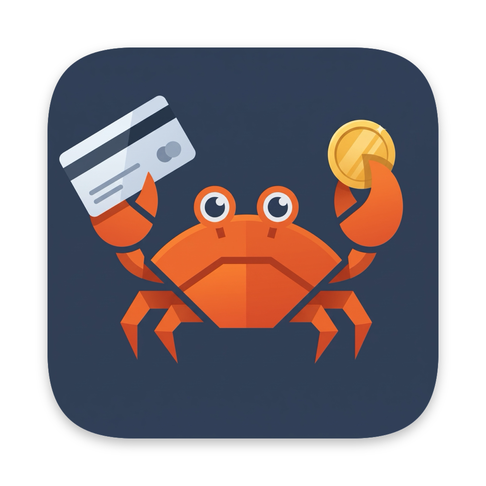
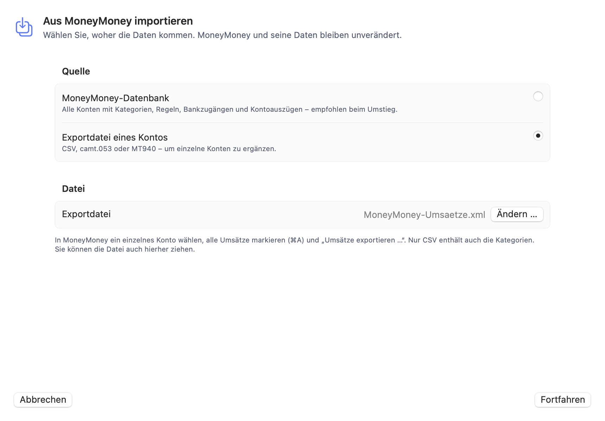
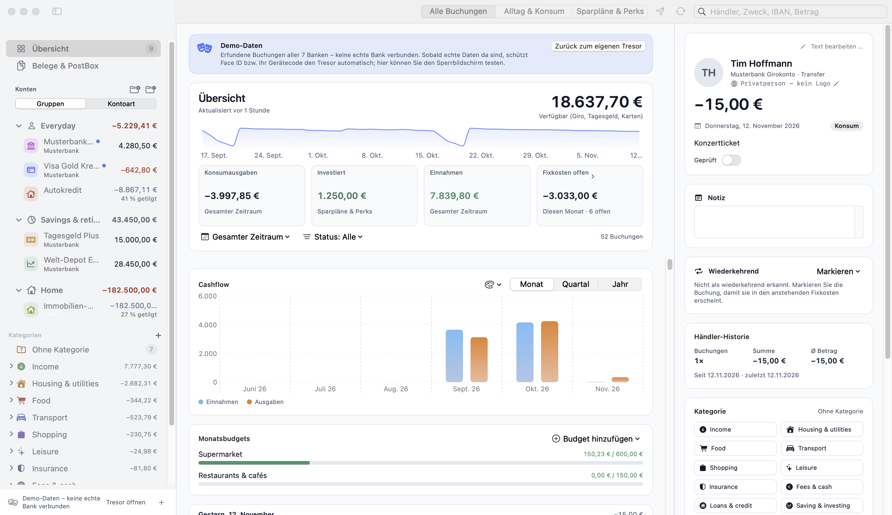
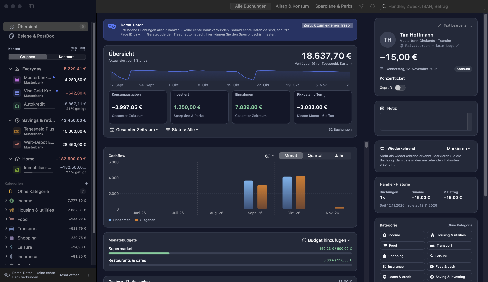
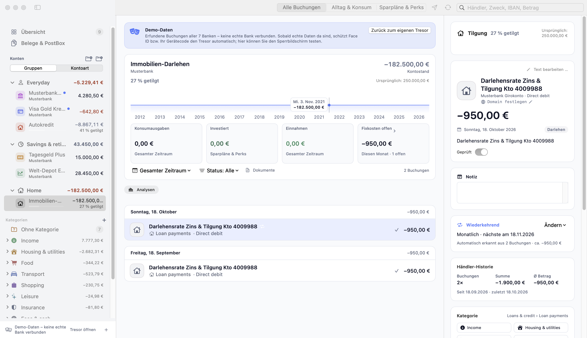
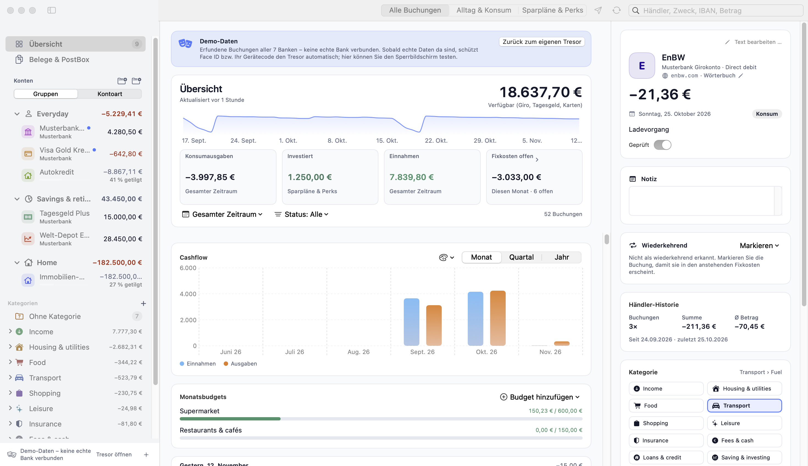
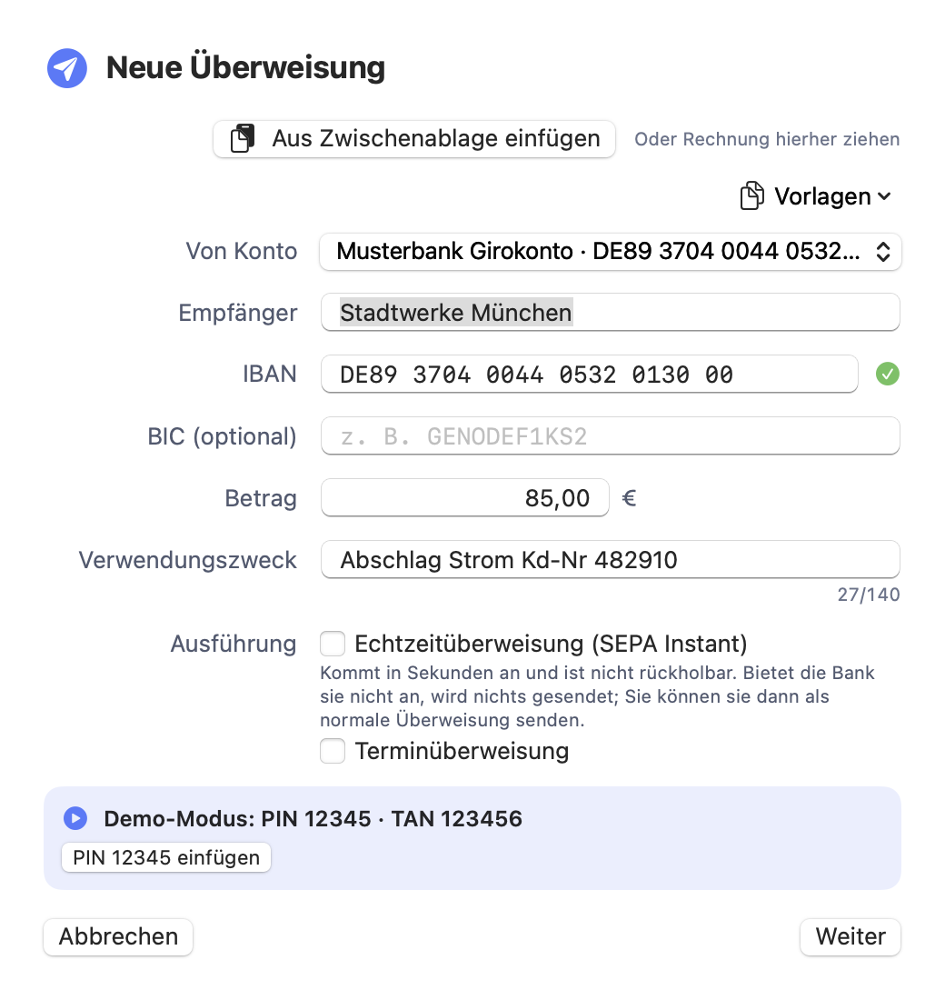

<p align="center">
  
</p>

<h1 align="center">GiroCrab</h1>

<p align="center">
  <a href="https://github.com/girocrab/girocrab/actions/workflows/ci.yml"></a>
  
  
  
  
  
</p>

<p align="center"><b>🇩🇪 <a href="#-deutsch">Deutsch</a> · 🇬🇧 <a href="#-english">English</a></b></p>

---

## 🇩🇪 Deutsch

**Open-Source-Banking für macOS 14+ – lokal, verschlüsselt, ohne Cloud.**
Native SwiftUI-App auf einem Rust-Kern: verschlüsselter Datentresor (XChaCha20-Poly1305 & Argon2id), Kategorienbaum,
Regeln, Händler-Erkennung, Sparplan-Ansicht, Darlehens-Tilgungsbalken und direkte Verbindungen
zu Ihren Banken – ohne Server, ohne Tracking.

### 🚚 Umzug von MoneyMoney in 60 Sekunden

Mehrjährige Historien, Kategorien und Notizen lassen sich verlustfrei übernehmen – ohne Abo-Bindung:

1. In MoneyMoney das Konto wählen, **⌘A**, **Umsätze exportieren …** → **XML** oder **CSV**.
2. In GiroCrab: *Von MoneyMoney wechseln* (Onboarding), *MoneyMoney-Import* (Seitenleiste) oder `⌘K` → „MoneyMoney Historie & Kategorien importieren“. Datei hineinziehen.
3. Zielkonto wählen (oder neues Archivkonto anlegen), Vorschau prüfen, **Importieren**.

<p align="center"></p>

Kategorien (`Haushalt\Lebensmittel`) bleiben als Baum erhalten, Notizen stehen in der Buchungsdetail-Ansicht.
Jeder Umsatz erhält einen Fingerabdruck (Datum, Betrag, IBAN/Name, Verwendungszweck): Ein erneuter Import
oder später per FinTS abgerufene, überlappende Tage erzeugen **keine Duplikate** – vorhandene Buchungen werden
nur um Kategorie und Notiz ergänzt.
**Gewohnte Komfort-Funktionen für Umsteiger:**
* **📋 Sm@rtPaste (`⌘V` / `⇧⌘V`):** Rechnungstexte oder Bankverbindungen aus der Zwischenablage direkt ins Überweisungsfenster einfügen – Empfänger, prüfsummengültige IBAN, BIC, Betrag und Verwendungszweck werden automatisch erkannt.
* **📄 E-Rechnungen & PDF-Drop:** PDF-Rechnungen einfach auf das Überweisungsfenster ziehen (liest eingebettetes **ZUGFeRD / Factur-X XML**, **EPC-QR-Codes / GiroCode** oder den PDF-Text).
* **✅ Geprüft-Häkchen (`Space`):** Umsätze in der Liste direkt per Leertaste als „geprüft“ markieren.
* **🖱️ Rechtsklick-Workflows:** Mit einem Klick alle Buchungen desselben Empfängers filtern (*„Nach ‚…‘ suchen“*) oder eine *„Neue Überweisung aus Buchung …“* vorausfüllen lassen.

### Funktionen im Überblick

<p align="center"></p>

<p align="center"></p>

*Alle Screenshots zeigen ausschließlich erfundene Demo-Daten (`GIROCRAB_DEMO_SEED=1`).*

- 🔒 **Local-First & Zero-Cloud:** Alle Bankdaten bleiben auf Ihrem Gerät – in einem verschlüsselten Tresor (XChaCha20-Poly1305), geschützt durch macOS-Schlüsselbund / Touch ID.
- 🏦 **Native deutsche Bank-Protokolle:** FinTS 3.0 / HBCI (CAMT.052 & MT940 mit intelligenter Latin-1/UTF-8-Erkennung), Trade-Republic-WebSocket, comdirect-REST sowie eingebettete Web-Session-/CSV-Importe für Amex & Amazon Visa.
- 💸 **SEPA-Überweisungen via FinTS 3.0 / HKCCS** inkl. PushTAN, SecureGo plus & ChipTAN/photoTAN: IBAN-Prüfung (Mod-97), SEPA-konformer Zeichensatz, Empfängervorschläge aus bisherigen Buchungen und sofort vorgemerkte Buchung.
- 🏠 **Intelligente Darlehens-Verfolgung:** Tilgungsfortschritt in Prozent und automatische Verknüpfung der monatlichen „Zins & Tilgung“-Raten vom Girokonto.
- 🏷️ **Markenlogos vs. private Monogramme:** Händler und ETFs (REWE, EnBW, DB, iShares) werden sofort erkannt; Privatpersonen (z. B. „Max Mustermann“) erhalten bewusst nur neutrale Initialen.
- 🌙 **macOS Dark Mode:** folgt automatisch dem System-Erscheinungsbild (Hell/Dunkel).
- 🌐 **Lokalisierung DE/EN:** Die App ist auf Deutsch und Englisch verfügbar und folgt der Systemsprache.

| Darlehen mit Tilgungsbalken | Inspektor mit Händler-Logo |
|---|---|
|  |  |

| SEPA-Überweisung mit IBAN-Prüfung | MoneyMoney-Import mit Vorschau |
|---|---|
|  |  |

### Architektur

```
┌──────────────────────────┐   UniFFI    ┌────────────────────────────────────┐
│ GiroCrabApp (SwiftUI)    │ ◄─────────► │ girocrab-core (Rust)               │
│ macOS 14+ (AppKit)       │  Swift-API  │  vault.rs      XChaCha20-Tresor    │
│ Keychain + Face/Touch ID │             │  rules.rs      Kategorien-Regeln   │
└──────────────────────────┘             │  merchants.rs  Händler-Erkennung   │
                                         │  connectors/   FinTS · REST · PSD2 │
                                         └──────────────┬─────────────────────┘
                                                        │ direkt, mit Ihren Zugangsdaten
                                                        ▼
                                                  Ihre Bank(en)
```

### Bank-Unterstützung

| Institut | Verfahren | Status |
|---|---|---|
| Volksbanken (Atruvia) / 1822direkt | FinTS 3.0 PIN/TAN (HKCAZ/camt, HKKAZ/MT940, Darlehen) | ✅ Unterstützt |
| comdirect | Offizielle REST-API | ✅ Unterstützt |
| PayPal | Transaction-Search-API | ✅ Unterstützt |
| Trade Republic | WebSocket (inoffiziell) | ⚠️ Unterstützt, kann brechen |
| American Express / Amazon Visa | PSD2 via Enable Banking | ✅ Unterstützt |
| ING, DKB, N26, Scalable Capital, Consorsbank, Santander | – | 🙋 **Help Wanted** |

Eine neue Bank anzubinden dauert meist unter 100 Zeilen: siehe
[`connectors/template.rs`](girocrab-core/src/connectors/template.rs) und [CONTRIBUTING.md](CONTRIBUTING.md).

### Schnellstart

Voraussetzungen: macOS 14+, Xcode 15+, [rustup](https://rustup.rs).

```bash
./build-xcframework.sh          # Rust-Kern + Swift-Bindings (macOS / XCFramework)
cargo run -- --demo-seed        # App mit erfundenen Demo-Daten starten
# oder: GIROCRAB_DEMO_SEED=1 cargo run

[](https://paypal.me/aprinz)
cargo test -p girocrab-core     # Tests
```

Die Demo enthält 5 fiktive Konten und 50 erfundene Buchungen – keine echten Daten.

### ⚖️ Rechtlicher Hinweis (ZAG / PSD2)

GiroCrab ist **selbst gehostete Software zur ausschließlich eigenen Nutzung**. Sie läuft auf Ihrem
Gerät und verbindet sich direkt – mit **Ihren** Zugangsdaten, **Ihrer** FinTS-Produktregistrierung
und **Ihren** API-Schlüsseln – mit Ihren Banken. Die Entwickler betreiben **keinen** Server, erhalten
**keine** Kontodaten und erbringen **keinen** Kontoinformations- (AISP) oder Zahlungsauslösedienst
(PISP) im Sinne des ZAG bzw. der Richtlinie (EU) 2015/2366 (PSD2). Wer GiroCrab für **Dritte**
betreibt, braucht ggf. eine BaFin-Erlaubnis – das ist nicht der vorgesehene Einsatzzweck.
Nutzung auf eigenes Risiko, keine Gewähr (siehe GPLv3). Inoffizielle Schnittstellen
(Trade Republic) können gegen Nutzungsbedingungen verstoßen. Keine Anlageberatung; ISIN/WKN-Angaben
sind Referenzdaten ohne Gewähr. Marken gehören ihren Inhabern und dienen nur der Wiedererkennung.

---

## 🇬🇧 English

**Open-source banking for macOS 14+ – local-first, encrypted, no cloud.**
A native SwiftUI app on a Rust core: encrypted vault (XChaCha20-Poly1305 & Argon2id), category tree, rules, merchant
recognition, savings-plan view, loan repayment progress and direct connections to your banks –
no server, no tracking. Money is always `i64` cents, never floats.

### 🚚 Migrating from MoneyMoney

Full multi-year histories, categories and notes import seamlessly – no subscription lock-in:

1. In MoneyMoney select the account, press **⌘A**, then **Export Transactions …** → **XML** or **CSV**.
2. In GiroCrab: *Switch from MoneyMoney* (onboarding), *MoneyMoney-Import* (sidebar) or `⌘K` → "MoneyMoney Historie & Kategorien importieren". Drop the file in.
3. Pick the target account (or create an archive account), check the preview, hit **Import**.

<p align="center"></p>

Hierarchical categories (`Household\Groceries`) are kept as a tree, notes show in the booking detail view.
Every booking gets a fingerprint (date, amount, IBAN/name, purpose), so re-importing the file or overlapping days
fetched later via FinTS **never create duplicates** – existing bookings are only enriched with category and note.
**Familiar everyday workflows:**
* **📋 Sm@rtPaste (`⌘V` / `⇧⌘V`):** Paste invoice text or bank details from the clipboard straight into the transfer sheet — recipient, checksum-verified IBAN, BIC, amount and purpose are filled in automatically.
* **📄 E-Invoice & PDF Drop:** Drag & drop a PDF invoice onto the transfer sheet (parses embedded **ZUGFeRD / Factur-X XML**, **EPC QR / GiroCode**, or PDF/OCR text).
* **✅ Checked toggle (`Space`):** Mark bookings as checked directly via the Spacebar.
* **🖱️ Context menu actions:** Right-click any booking to filter all transactions by that counterparty or pre-fill a new transfer from the booking.
### Features & Screenshots

<p align="center"></p>

<p align="center"></p>

*All screenshots show purely fictional demo data (`GIROCRAB_DEMO_SEED=1`).*

- 🔒 **Local-first & zero-cloud privacy:** all banking data lives on your device in an encrypted vault (XChaCha20-Poly1305) protected by the macOS Keychain / Touch ID.
- 🏦 **Native German banking protocols:** FinTS 3.0 / HBCI (CAMT.052 & MT940 with smart Latin-1/UTF-8 decoding), Trade Republic WebSocket, comdirect REST, and embedded web-session/CSV import for Amex & Amazon Visa.
- 💸 **Native SEPA credit transfers via FinTS 3.0 / HKCCS** incl. PushTAN, SecureGo plus & ChipTAN/photoTAN: IBAN checksum validation (Mod-97), SEPA-compliant character set, recipient suggestions from past bookings and an instant pending booking.
- 🏠 **Smart loan tracking:** automatic repayment progress (%) and cross-account linking of the monthly "Zins & Tilgung" instalments from your checking account.
- 🏷️ **Brand signets vs. private monograms:** instant recognition for German merchants & ETFs (REWE, EnBW, DB, iShares), while private individuals (e.g. "Max Mustermann") get plain monogram initials by design.
- 🌙 **macOS Dark Mode:** automatically follows the system appearance (light/dark).
- 🌐 **German & English localization:** the app ships in German and English and follows the system language.

| Loan with repayment bar | Inspector with merchant logo |
|---|---|
|  |  |

| SEPA transfer with IBAN check | MoneyMoney import with preview |
|---|---|
|  |  |

### Architecture

See the diagram above: the SwiftUI app talks to `girocrab-core` through UniFFI; the core owns the
encrypted vault, categorisation rules, merchant resolver and the bank connectors, and talks to
your bank directly.

### Bank support matrix

| Bank | Protocol | Status |
|---|---|---|
| Volksbanken (Atruvia) / 1822direkt | FinTS 3.0 PIN/TAN (camt, MT940, loans) | ✅ Supported |
| comdirect | Official REST API | ✅ Supported |
| PayPal | Transaction Search API | ✅ Supported |
| Trade Republic | WebSocket (unofficial) | ⚠️ Supported, may break |
| American Express / Amazon Visa | PSD2 via Enable Banking | ✅ Supported |
| ING, DKB, N26, Scalable Capital, Consorsbank, Santander | – | 🙋 **Help wanted** |

Adding a bank usually takes under 100 lines – start from
[`connectors/template.rs`](girocrab-core/src/connectors/template.rs) and read [CONTRIBUTING.md](CONTRIBUTING.md).

### Download (macOS)

Pre-built `GiroCrab-macOS-arm64.zip` binaries (Apple Silicon, macOS 14+) are available under
[GitHub Releases](../../releases) – no Rust or Xcode required. Unzip and move `GiroCrab.app` to `/Applications`.

The open-source builds are not notarized. If macOS refuses to open the app, run
`xattr -cr /Applications/GiroCrab.app` or Right-Click → Open.

### Quickstart

Requirements: macOS 14+, Xcode 15+, [rustup](https://rustup.rs).

```bash
./build-xcframework.sh          # Rust core + Swift bindings (macOS / XCFramework)
cargo run -- --demo-seed        # launch the app with fictional demo data
# or: GIROCRAB_DEMO_SEED=1 cargo run
cargo test -p girocrab-core     # run the tests
```

The demo ships 5 fictional accounts and 50 invented bookings – no real data.

### ⚖️ Legal notice (PSD2 / ZAG)

GiroCrab is **self-hosted software for your own personal use only**. It runs on your device and
connects directly to your banks with **your** credentials, **your** FinTS product registration and
**your** API keys. The authors operate **no** server, receive **no** account data and provide **no**
account-information (AISP) or payment-initiation (PISP) service under the German ZAG / PSD2
(Directive (EU) 2015/2366). Operating GiroCrab for **third parties** may require BaFin authorisation
and is not the intended use. Use at your own risk, no warranty (see GPLv3). Unofficial interfaces
(Trade Republic) may violate terms of service. Not investment advice. Trademarks belong to their
owners and are used for identification only.

---

## Security / Sicherheit

XChaCha20-Poly1305 + Argon2id encrypted vault, key in the Keychain (`ThisDeviceOnly`), PINs/TANs only in memory
(`zeroize`), no telemetry. **Never attach real bank data or credentials to issues.**

## License / Lizenz

GPL-3.0-or-later – see [LICENSE](LICENSE).

---

## ☕ Projekt unterstützen (Freiwillige Zuwendung)

**GiroCrab** ist ein freies Open-Source-Projekt. Wenn dir die App im Alltag hilft und du die Weiterentwicklung mit einer kleinen **freiwilligen Zuwendung** (ohne Gegenleistung) für die Kaffeekasse unterstützen möchtest:

[](https://paypal.me/aprinz)

*English:* If you enjoy using GiroCrab and would like to support its development with a **voluntary contribution / tip** (no consideration expected): **[paypal.me/aprinz](https://paypal.me/aprinz)**

---

📄 **Open-Source-Lizenzen / Third-Party Notices:** Eine Übersicht aller im Rust-Kern verwendeten Open-Source-Bibliotheken und ihrer Lizenzen befindet sich in [THIRD_PARTY_NOTICES.md](THIRD_PARTY_NOTICES.md).
